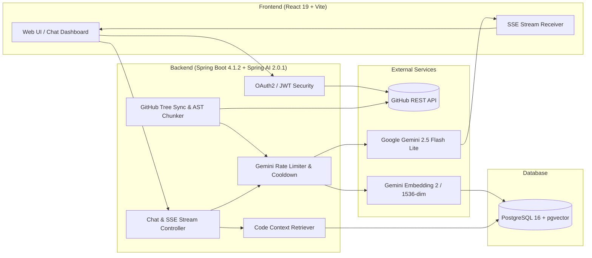

# DevPilot 🚀

> **An intelligent, context-aware AI assistant for exploring, understanding, and chatting with your GitHub repositories using RAG, Google Gemini, and PostgreSQL pgvector.**

---

## Overview

**DevPilot** turns any GitHub repository into an interactive, semantic knowledge base. Connect your GitHub account, index your repositories with smart incremental caching, and query your codebase in natural language with grounded answers, live streaming chat, and precise file citations.

---

## Key Features

- **GitHub OAuth & Repository Sync**: Seamlessly authenticate via GitHub OAuth2 to list and select personal or organization repositories.
- **Incremental Code Indexing**: Tracks Git blob SHAs (`fileSha`) to index only modified or new files, drastically reducing API calls and avoiding redundant computations.
- **pgvector Semantic Search**: Stores deterministic 1536-dimensional embeddings in PostgreSQL via `pgvector` for fast cosine similarity retrieval.
- **Dimension Enforcement & Quota Resilience**:
  - Enforces exact 1536-dimensional output from Google's `gemini-embedding-2` model, preventing database schema mismatches without lossy zero-padding or truncation.
  - Built-in rate limiter (default 60 RPM) with concurrency throttling, exponential backoff with jitter, `Retry-After` parsing, and automatic global cooldown on HTTP 429 quota limits.
- **Grounded RAG Pipeline**: Context budget management (character bounds to prevent token overflow) and structured prompts instructing the model to cite exact repository file paths and acknowledge unreferenced logic.
- **Real-Time Streaming Chat (SSE)**: Streams responses chunk-by-chunk via Server-Sent Events with Markdown parsing, syntax highlighting, and persistent chat sessions.
- **Health & Diagnostic Monitoring**: Dedicated `/api/health` endpoint and startup dimension verification checking database connectivity, pgvector extensions, and embedding model alignment before serving requests.
- **Modern Responsive UI**: Built with React 19, TypeScript, Vite, Tailwind CSS v4, Lucide icons, and shadcn/ui.

---

## Architecture



---

## Technology Stack

### Backend
- **Language & Runtime**: Java 21 (JDK 21)
- **Framework**: Spring Boot 4.1.2
- **AI Framework**: Spring AI 2.0.1
- **LLM**: Google Gemini 2.5 Flash Lite (`gemini-2.5-flash-lite`)
- **Embeddings**: Google Gemini Embedding 2 (`gemini-embedding-2`, configured to 1536 dimensions)
- **Database**: PostgreSQL 16 with `pgvector` extension
- **Security**: Spring Security 6 with OAuth2 Client (GitHub)
- **Persistence**: Spring Data JPA / Hibernate
- **Build Tool**: Maven 3.9+ / Maven Wrapper

### Frontend
- **Framework**: React 19 with TypeScript
- **Bundler**: Vite 8
- **Styling**: Tailwind CSS v4, Lucide Icons, shadcn/ui
- **State & Data Fetching**: TanStack React Query v5
- **Streaming & Highlighting**: Streamdown, Shiki syntax highlighter

### Infrastructure
- **Containerization**: Docker Compose (`pgvector/pgvector:pg16` on host port `5433`)

---

## Getting Started

### Prerequisites

1. **Java 21**: Make sure JDK 21 is installed (`java -version`).
2. **Node.js**: Node 18+ and npm (`node -v`, `npm -v`).
3. **Docker**: Docker Desktop or Docker Engine running.
4. **Google Gemini API Key**: Obtain from [Google AI Studio](https://aistudio.google.com/).
5. **GitHub OAuth App**: Create an OAuth application at [GitHub Developer Settings](https://github.com/settings/developers):
   - **Homepage URL**: `http://localhost:5173`
   - **Authorization callback URL**: `http://localhost:8080/login/oauth2/code/github`

---

### Step 1: Start PostgreSQL with pgvector

Use Docker Compose to start the PostgreSQL database on host port `5433`:

```bash
docker compose up -d postgres
```

Verify that the database is running:

```bash
docker ps --filter "name=devpilot-postgres"
```

---

### Step 2: Configure Environment Variables

#### Backend Configuration
Copy the example environment file in `Backend`:

```bash
cd Backend
cp .env.example .env
```

Configure your credentials in `.env` (or pass as system environment variables):

```properties
# Database (Matches docker-compose.yml on host port 5433)
DB_url=jdbc:postgresql://localhost:5433/devpilot
DB_USERNAME=postgres
DB_PASSWORD=postgres

# Google Gemini API
GOOGLE_API_KEY=your_gemini_api_key_here
GOOGLE_MODEL=gemini-2.5-flash-lite
GOOGLE_EMBEDDING_MODEL=gemini-embedding-2
GEMINI_RATE_LIMIT_RPM=60

# GitHub OAuth Credentials
GITHUB_CLIENT_ID=your_github_client_id_here
GITHUB_CLIENT_SECRET=your_github_client_secret_here

# Frontend & CORS
FRONTEND_URL=http://localhost:5173
CORS_ALLOWED_ORIGINS=http://localhost:5173,http://localhost:3000

# Token Encryption
TOKEN_ENCRYPTOR_PASSWORD=devpilot-secret-token-key-password
TOKEN_ENCRYPTOR_SALT=5c0744940b5c369b
```

#### Frontend Configuration
Copy the frontend environment file in `client/frontend`:

```bash
cd client/frontend
cp .env.example .env
```

Ensure the backend URL matches:

```properties
VITE_API_BASE_URL=http://localhost:8080
```

---

### Step 3: Run the Backend

From the `Backend` directory:

```bash
# Using Maven Wrapper (Linux/macOS)
./mvnw spring-boot:run

# Using Maven Wrapper (Windows PowerShell)
.\mvnw.cmd spring-boot:run

# Or with installed Maven
mvn spring-boot:run
```

Once started, verify the service health and dimension diagnostics at:
- Health Check: `http://localhost:8080/api/health`

---

### Step 4: Run the Frontend

From the `client/frontend` directory:

```bash
cd client/frontend
npm install
npm run dev
```

Open your browser at:
- `http://localhost:5173`

---

## Running Tests

To run the unit test suite verifying rate limiting, chunking, dimension enforcement, and context retrieval:

```bash
cd Backend
mvn test -Dtest=DimensionEnforcingEmbeddingModelTest,GeminiRateLimiterTest,CodeChunkerTest,CodeContextRetrieverTest
```

---

## API Endpoints Overview

| Method | Endpoint | Description | Auth Required |
|---|---|---|---|
| `GET` | `/api/health` | Diagnostic health & embedding dimension verification | No |
| `GET` | `/login/oauth2/code/github` | OAuth2 callback for GitHub login | Handled by Spring Security |
| `GET` | `/api/user/me` | Current authenticated user profile | Yes |
| `GET` | `/api/repositories` | List tracked repositories | Yes |
| `POST` | `/api/repositories/sync` | Fetch user repositories from GitHub | Yes |
| `POST` | `/api/repositories/{id}/index` | Trigger incremental code indexing | Yes |
| `GET` | `/api/repositories/{id}/status` | Check indexing status & progress | Yes |
| `POST` | `/api/chat/stream` | Stream LLM chat response with RAG context (SSE) | Yes |
| `GET` | `/api/chat/sessions` | Retrieve previous chat conversations | Yes |

---

## License

This project is licensed under the MIT License. See [LICENSE](LICENSE) for details.
